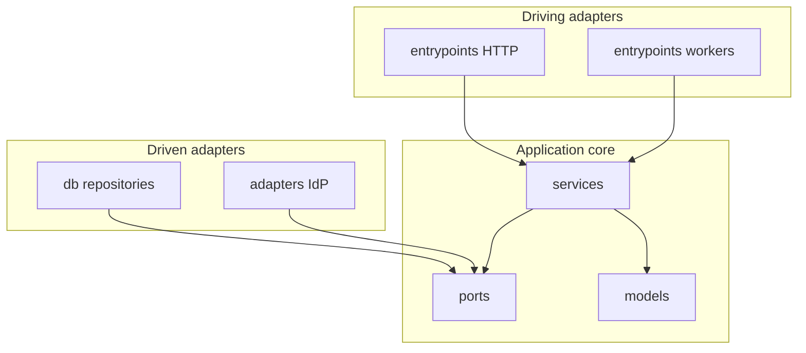

# Hexagonal architecture — layered folders

Portable template for a Python backend organized as a **hexagon**: application core in the center, **ports** as contracts, **adapters** at the edges. This cell is **hexagonal + layered**: technical folders live at `src/` root (not grouped by domain).

Related context:

| Document | Focus |
| -------- | ----- |
| **`.agents/context/api-layer-design.md`** | HTTP handler rhythm, wire schemas, response envelope |
| **`.agents/context/auth-patterns.md`** | Auth-at-edge checklist |

When project `docs/` files are missing, infer from **live code** in the folders below. Optional override: `docs/BACKEND_PROJECT_LAYOUT.md`.

**Folder structure marker:** technical layers at `src/entrypoints/`, `src/ports/`, `src/adapters/` (not `src/<domain>/`).

---

## 1. Hexagon (strict)

The core (`services`, `models`, `ports`) does **not** import FastAPI, boto3, Dynamo/SQL drivers, or Cognito SDKs. Infrastructure implements ports; HTTP/workers **drive** the core.

| Piece | Responsibility | Must **not** do |
| ----- | -------------- | --------------- |
| **Ports** | `Protocol` / ABC contracts the core needs or offers (repositories, IdP, clocks, publishers). | Know HTTP, JSON wire formats, or cloud SDKs. |
| **Services** | Use cases. Depend on **ports**. Accept command/query DTOs; return read DTOs or raise `DomainError`. | Import adapters, `db` clients, or FastAPI types. |
| **Domain models** | Entities / values and documented invariants. | Know HTTP or persistence drivers. |
| **Service DTOs** | Commands, queries, read projections at the application boundary. | Become the public HTTP contract (that is wire schemas). |
| **Driven adapters** | `db/` repositories, `adapters/` IdP/SDK façades. Implement ports; map driver rows ↔ domain models. | Own multi-step business workflows. |
| **Driving adapters (entrypoints)** | HTTP, workers, IdP triggers. Validate input, auth at the edge, assemble **one** service DTO, call **one** service method, wrap `ApiResponse`. | Import domain models, ports' concrete adapters, or repositories. |
| **Core** | Config, `TokenPayload` / `RequireRole`, `ApiResponse`, pagination, logging, composition root (`injector`). | Feature logic. |



**DI:** collaborators are constructor-injected. The **composition root** (`core/dependencies.py`) is the only place that binds ports to adapter classes. Entrypoints resolve services via getters (`Depends(get_*_service)`), never `Service(DynamoRepo())`.

---

## 2. Layered tree

Application root: `src/`. Import prefix: `src.` (customize if the package name differs). Optional local runner: `src/local_main.py`.

```
src/
├── entrypoints/         # driving adapters: HTTP, workers, IdP triggers
├── services/            # application / use cases
│   └── dto/             # commands, queries, read DTOs
├── models/              # domain types
├── ports/               # contracts (Protocol / ABC)
├── adapters/            # driven adapters that are not persistence (IdP, email, …)
├── db/                  # persistence adapters (repositories, transactions)
├── core/                # config, envelope, auth primitives, injector
├── commons/             # optional low-level SDK helpers
└── local_main.py
```

Repo siblings (not import layers): `tests/`, `infra/`, `scripts/`.

Monorepo: backend may live under `backend/`; set application root and import prefix accordingly.

### Entrypoints (HTTP and other drivers)

HTTP lives under **`entrypoints/`**, not a catch-all `api/` package (legacy trees may still use `api/` — follow **this** tree for new code).

Shared HTTP utilities (often flat under `entrypoints/`):

| Location | Responsibility |
| -------- | -------------- |
| `entrypoints/deps.py` | `Depends(...)` factories: resolve services from the composition root. |
| `entrypoints/commons.py` | Request context, `wire_response`, exception handler registration. |
| `entrypoints/wire_enums.py` | Enums for OpenAPI only — not `models/` enums. |

One subpackage per HTTP surface when authorizers or blast radius differ (`entrypoints/admin/`, `entrypoints/carrier/`): `main.py`, `handler.py` (Mangum), `schemas.py`, `routes.py` or `routes/`.

Optional: `entrypoints/<surface>/security.py`, `entrypoints/auth/` (IdP trigger Lambdas), `entrypoints/workers/` (scheduled/stream). Same rule: parse event → **one service method**.

### Ports and adapters

| You are adding… | Location |
| --------------- | -------- |
| Repository / IdP / publisher contract | `ports/<name>.py` |
| Persistence implementation | `db/<aggregate>_repository.py` |
| Cognito or other SDK façade | `adapters/idp.py` (or `adapters/<vendor>.py`) |
| Use case | `services/<feature>.py` |
| Command / query / read DTO | `services/dto/<feature>.py` |
| Domain type | `models/<aggregate>.py` |
| HTTP route + wire schema | `entrypoints/<surface>/routes*.py`, `schemas.py` |
| Composition root bindings | `core/dependencies.py` plus adapter modules |

Services import **ports**, not `db.*` concrete classes.

---

## 3. Triple representation

Do **not** collapse HTTP, use-case, and persistence into one Pydantic model.

| Representation | Where | Role |
| -------------- | ----- | ---- |
| Wire / OpenAPI schema | entrypoints | JSON for clients; `extra="forbid"`; **wire enums** |
| Service DTO | services | Commands / queries / reads. Filters often enter as strings. |
| Domain model | models | Stored truth and domain language |

HTTP can rename fields without leaking storage; domain models can track keys without coupling OpenAPI.

---

## 4. Handler rhythm (driving adapter)

Every HTTP handler:

1. Build `dto = ...` from path, body, and request metadata (audit context on writes).
2. Call **exactly one** service method: `result = some_service.method(dto)`.
3. Return `ApiResponse` / `paginated`, mapping read DTOs with `wire_response` when shapes align.

Entrypoints must **not** import `models/` or `db/`. Enums that cross HTTP → services come from **wire enums** (pass `.value` as strings). See **`.agents/context/api-layer-design.md`** for line-by-line FastAPI examples (map `api` in those samples to `entrypoints` in this tree).

---

## 5. Services, ports, persistence

- Commands bundle `request` + `MutationAuditContext` for audited writes.
- Services depend on **ports**; return read DTOs, not driver rows.
- One repository **port** per aggregate (or bounded-context slice). Methods are use-case-shaped (`get_by_id`, `transact_write_entity_and_audit`).
- Map driver rows ↔ domain models **inside** the adapter. Services never parse raw Dynamo/SQL items.
- Transactions: services decide *what* is atomic; `db/` implements *how*.
- Cursor pagination: opaque `next_cursor` from **core** helpers.

---

## 6. Composition root, workers, Lambda

- One `Injector` per Lambda execution environment; bind ports → adapters there.
- Workers and IdP triggers use the **same** services; they do not bypass the hexagon.
- Separate Lambdas per HTTP surface when IAM or blast radius differ. API Gateway: explicit resources, no `{proxy+}`. JWT at the authorizer; send the ID token as `Authorization: Bearer`.
- CORS: Gateway handles OPTIONS/errors; successful JSON needs `CORSMiddleware` on the app (`ALLOWED_ORIGINS` aligned with infra).

---

## 7. Identity

Token authenticity at the gateway. `TokenPayload` / `RequireRole` in **core**. Business authorization in **services**. IdP adapter is a **driven adapter** (thin SDK). Registration and PostConfirmation: entrypoint parses the event → one service method. Details: **`.agents/context/auth-patterns.md`**.

---

## 8. Core paths

| Area | Path |
| ---- | ---- |
| Auth primitives | `core/auth.py` |
| Settings | `core/config.py` |
| Composition root | `core/dependencies.py` |
| Domain errors | `core/exceptions.py` |
| Response envelope | `core/response.py` |
| Pagination | `core/pagination.py` |
| Middleware | `core/middleware/setup.py` |

---

## 9. Checklist

- [ ] New HTTP code lives under `entrypoints/`; no `models/` or `db/` imports there.
- [ ] Services depend on `ports/`, not concrete adapter classes.
- [ ] Bindings only in the composition root.
- [ ] One service call per entrypoint; DTO in, envelope out.
- [ ] Wire schemas ≠ service DTOs ≠ domain models.
- [ ] Tests of services use fakes of ports (no AWS required).

---

## Agent scope globs

| Layer | Glob |
| ----- | ---- |
| HTTP / workers | `src/entrypoints/**` |
| Services | `src/services/**` |
| Ports | `src/ports/**` |
| Driven adapters | `src/adapters/**` |
| Persistence | `src/db/**` |
| Domain models | `src/models/**` |
| Core | `src/core/**` |
