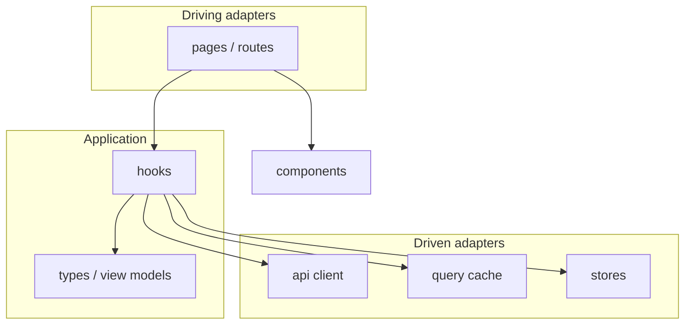

# Frontend architecture — layered folders

Portable template for a Vite + React app organized as **technical layers** at
`src/` root (`components/`, `pages/`, `api/`, `stores/`, …) — not grouped by
feature. UI and HTTP are adapters; feature hooks sit in the middle.

Related context:

| Document | Focus |
| -------- | ----- |
| **`.agents/context/frontend-component-design.md`** | Props, composition, a11y (path-agnostic) |
| **`.agents/context/frontend-state-design.md`** | HTTP client, services, query keys, client stores |

When project `docs/` files are missing, infer from **live code** in the folders
below. Optional overrides: `docs/COMPONENT_DESIGN.md`, `docs/STATE_DESIGN.md`.

**Folder structure marker:** technical folders at `src/` root (not `src/features/<domain>/`).

This cell is **layered**. For feature folders use `--fs per-domain`.

---

## 1. Core (strict)

The UI does **not** own network calls, cache keys, or persistence. Pages drive
hooks; hooks talk to ports (API client, stores); adapters implement those ports.

| Piece | Responsibility | Must **not** do |
| ----- | -------------- | --------------- |
| **Pages / routes** | Driving adapters. Read route params, call **one** feature hook (or a small set), pass view-model props down. | Call `fetch` / axios; import wire DTOs into JSX. |
| **Presentational components** | Markup, layout, variants, a11y. Props in, events out. | Fetch, write a global store, know route params. |
| **Feature hooks** | Use cases. Depend on the API client and stores. Return view models + status. | Render JSX; parse raw HTTP in every caller. |
| **API client** | Driven adapter. Base URL, auth header, error mapping, typed fetchers. | Own multi-step UI workflows. |
| **Query/cache** | Driven adapter for **server** state (TanStack Query, SWR, …). | Hold ephemeral UI flags (sidebar open, wizard step). |
| **Client stores** | Driven adapter for **client** state (Zustand, Context, …). Session, theme, drafts. | Duplicate server lists “for convenience.” |
| **View models / types** | What the UI thinks in. Mapped from wire at the client or in `select`. | Be the same type as the JSON payload **and** component props. |
| **App shell** | Composition root: router, QueryClient, session provider. | Feature logic. |



**Providers:** `App.tsx` (or `main.tsx`) is the only place that constructs the
query client, router, and session provider. Pages do not create new clients.

---

## 2. Layered tree

Application root: `src/`. Vite default. Optional file-based routing (`src/pages/`
or `src/routes/`) — follow **this** tree for new code.

```
src/
├── pages/ or routes/    # driving: route-level containers
├── components/          # shared presentational primitives and composites
├── hooks/               # feature hooks + small UI hooks
├── api/                 # HTTP client, typed fetchers, error mapping
├── stores/              # client/global stores (session, chrome, drafts)
├── types/               # view models and shared domain-ish types
├── lib/                 # query client, env, pure helpers
└── App.tsx              # shell / providers
```

Repo siblings (not import layers): `tests/` or colocated `*.test.tsx`, `public/`.

Monorepo: frontend may live under `frontend/`; set application root accordingly.

### Where new code lands

| You are adding… | Location |
| --------------- | -------- |
| Route / screen | `pages/` (or `routes/`) |
| Presentational UI | `components/` |
| Feature hook (use case) | `hooks/` |
| Typed fetcher / client | `api/` |
| Client store | `stores/` |
| View-model type | `types/` |
| QueryClient, env, helpers | `lib/` |

Do **not** invent `src/features/` in a layered app. If a second product domain
appears and `components/` / `hooks/` become dumping grounds, switch to
`--fs per-domain`.

---

## 3. Triple representation

Do **not** collapse HTTP, UI, and forms into one TypeScript type.

| Representation | Where | Role |
| -------------- | ----- | ---- |
| Wire / DTO | `api/` | JSON from the backend; Zod (or equivalent) at the boundary |
| View model | `types/` or hook `select` | What hooks return to pages |
| Component props | `components/` | What presentational UI needs |

HTTP can rename fields without leaking storage names into buttons.

---

## 4. Page rhythm (driving adapter)

Every page / route container:

1. Read params and search from the router (shareable filters live in the URL).
2. Call feature hook(s): `const q = useOrder(id)`.
3. Pass **view-model props** and status (`loading` / `error` / `empty`) to presentational children.

Pages must **not** import the raw fetch client for ad-hoc calls. Types →
services (no React) → hooks → page. Details:
**`.agents/context/frontend-state-design.md`**.

---

## 5. Hooks, API, stores

- **HTTP client** in `lib/` or `api/client` — instance, interceptors, 401.
- **Service functions** — one per remote operation; unwrap envelopes; no React.
  Split large files by **API surface**, not by screen. Legacy trees may keep
  fetchers next to the client under `api/`.
- **Hooks** — key factory, queries, mutations, invalidation.
- **Client state** (session, theme, wizard draft) lives in `stores/`.
- Map wire → view model **inside** services or a query `select`. Components
  never see wire types.
- Auth tokens come from the session store or an httpOnly cookie flow — not
  `localStorage` scraped in every call.

---

## 6. Composition root

- One `QueryClient` (or equivalent) created next to the router.
- Session / theme providers wrap the tree in `App.tsx`.
- Env (`VITE_*`) is read in `lib/` or `api/`, not sprinkled through components.

---

## 7. Identity

Login UI is a page. The session **store** holds the snapshot the client needs
(display name, roles). The API client attaches the token. Business authorization
still belongs on the **backend**; the UI only hides affordances.

---

## 8. Core paths

| Area | Path |
| ---- | ---- |
| Providers / router | `App.tsx`, `main.tsx` |
| HTTP client | `api/client.ts` (or `api/index.ts`) |
| Query defaults | `lib/queryClient.ts` |
| Session store | `stores/session.ts` |
| Shared primitives | `components/` |

---

## 9. Checklist

- [ ] New screens live under `pages/` (or `routes/`); they do not `fetch`.
- [ ] Presentational components take props; no wire types.
- [ ] Hooks depend on `api/` + `stores/`, not on JSX.
- [ ] Server lists are not copied into Zustand.
- [ ] Wire schemas ≠ view models ≠ component props.
- [ ] Tests of hooks mock the API client (no network required).

---

## Agent scope globs

| Layer | Glob |
| ----- | ---- |
| Pages / routes | `src/pages/**`, `src/routes/**` |
| Components | `src/components/**` |
| Hooks | `src/hooks/**` |
| API client | `src/api/**` |
| Stores | `src/stores/**`, `src/store/**` |
| Types | `src/types/**` |
| Lib / providers | `src/lib/**`, `src/App.tsx` |
