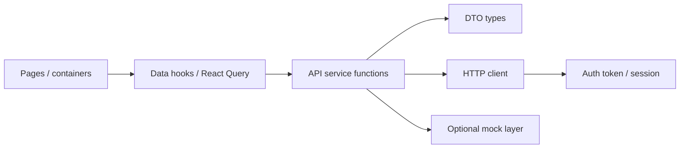

# Frontend state and data-layer design

Portable conventions for **client state**, **server state**, and the **browser
HTTP layer** in Vite + React apps. Does not own presentational components,
routing tables, or build config.

> **Not the backend API doc.** Server-side HTTP lives in
> **`.agents/context/api-layer-design.md`**. This file is the **browser client**
> only.

Related context:

| Document | Focus |
| -------- | ----- |
| **`.agents/context/frontend-architecture.md`** | Folder tree for **this** project (`--fs layered` or `per-domain`) |
| **`.agents/context/frontend-component-design.md`** | Component contracts, composition, a11y |
| `docs/STATE_DESIGN.md` | Project-specific overrides when present |

When project `docs/` files are missing, infer from **live stores, hooks, and
API modules** under `src/`. Physical paths live in **frontend-architecture.md**.

---

## Role of the state layer

This layer is the **only place** that talks to REST/GraphQL backends and most
third-party HTTP APIs. It owns DTO types, request functions, response
unwrapping, query/mutation hooks, and client-only stores. Pages and
presentational components stay free of raw HTTP clients and scattered env reads.

Keep three kinds of state distinct:

| Kind | Lives in | Examples |
| ---- | -------- | -------- |
| **Local UI** | Component `useState` / uncontrolled inputs | Accordion open, input draft, hover |
| **Client/global** | A store (Zustand, Redux, Context, signals) | Auth session snapshot, theme, wizard draft, toasts |
| **Server** | A query/cache library (TanStack Query, SWR, RTK Query) or equivalent | Lists, detail records, mutations against the API |

Do **not** dump server records into a global store “for convenience.” That
duplicates the cache and goes stale. Do **not** put ephemeral UI flags in the
query cache. Do **not** own routing, layout, or presentational UI.

---

## Layered flow



| Piece | Owns | Must not |
| ----- | ---- | -------- |
| **Types** | Envelopes, entities, query-param types, wire enums | HTTP calls |
| **HTTP client** | Base URL, interceptors, auth header, error normalization | Business DTOs, React |
| **Services** | One function per remote operation; unwrap envelopes; mocks | React imports |
| **Hooks** | Query keys, queries, mutations, invalidation | JSX |
| **Client stores** | Session, chrome, drafts — not server lists | Fetch policy |
| **Pages** | Compose hooks; loading/error UX | Direct HTTP client |

Map these pieces onto the folders in **frontend-architecture.md** (layered:
`types/`, `api/` or `lib/` + service modules, `hooks/`, `stores/`; per-domain:
the same roles under `features/<domain>/` plus `shared/`).

---

## Folder conventions

Physical paths live in **`.agents/context/frontend-architecture.md`**. One
module (or one module per backend surface) beats `fetch` in JSX.

When a service or hooks file grows past ~400–500 lines or mixes unrelated API
surfaces, **split by API surface / tenant / version**, not by screen name. In
the per-domain tree the feature folder *is* the surface — still name functions
by operation (`listItems`), never by page (`PaymentsPage`).

---

## Type contracts

Define once, consume in services and hooks:

- **Response envelope** — e.g. `ApiResponse<T>` with `success`, `data`, `error`,
  `meta` when the backend uses a standard wrapper.
- **Paged lists** — normalize cursor/page fields from `meta` (wire shape may be
  an array in `data` + cursor in `meta`).
- **Query objects** — typed filters passed as HTTP query params.
- **Wire enums** — string unions aligned with the API; do not duplicate
  status/role literals in components.

Add new request/response shapes **before** service functions and hooks. Map
wire → view model in the service or a query `select`, not in presentational
components.

---

## HTTP client

Single configured instance (Axios, fetch wrapper, or equivalent):

| Concern | Pattern |
| ------- | ------- |
| Base URL | From central config; dev proxy path when unset |
| Request | Correlation/request id header; bearer (or cookie) via the **session store / auth provider** |
| 401 / session end | Clear client session, sign out, redirect to login; guard duplicate handling on concurrent requests |
| Other errors | Normalize via a shared helper; **avoid duplicate global toasts** in both interceptor and UI |

Features and hooks do **not** import the HTTP client directly. Token refresh
belongs in the auth provider / request path; a 401 after that usually means
session end, not “retry once in the interceptor.”

Third-party SDKs (payments, maps, …) get **typed service wrappers**; pages do
not call SDKs directly. Env and secrets via central config, never in components.

---

## Service functions

- **One exported function per backend operation** (REST call or RPC).
- Thin helpers (`getData`, `getPage`, `postData`, …) unwrap envelopes and
  normalize pagination.
- **No React** in service modules.
- Name by **operation** (`listItems`, `updateItem`), not by screen.
- Preserve signatures consumed by hooks until call sites are updated.
- Keep mock branches **in the same module** as the live call.

---

## Server state (queries and mutations)

Co-locate a **key factory** (`queryKeys`, `apiKeys`, …) with hooks. Prefix by
**API realm or resource**, not page/component names. Embed **serializable
filter params** in keys when they change the response. Use **separate key
families** for heavy aggregates vs paginated lists so broad `invalidateQueries`
does not wipe expensive caches.

Illustrative shapes (adapt to your API):

```ts
["resource", "list", query ?? {}]
["resource", "detail", id]
["resource", "aggregate", filters]  // distinct from list
```

Hook rules:

- Import **only** from service modules (paths per **frontend-architecture.md**).
- Name hooks by **operation** (`useItem`, `useUpdateItem`).
- Pass `signal` (or equivalent) from `queryFn` when the client supports cancellation.
- Set `staleTime` / `gcTime` / `placeholderData` deliberately for stable pickers
  and calendars — one-line comment when non-default.
- Co-locate **invalidation** with mutations; prefer the key factory over
  ad-hoc string arrays.
- Loading, error, and empty are **first-class UI states**. Containers pass
  them down; presentational components render them.
- Dedupe in-flight requests via the library; do not roll your own cache unless
  the project already has one.

---

## Cache invalidation

On mutation success, invalidate the **smallest consistent set**:

- Detail keys for affected entities.
- List prefixes when list rows change.
- **Cross-surface** keys when multiple UIs show the same entity.
- Aggregate/calendar keys **explicitly** when they use a separate key family
  from paginated lists.

Document non-obvious invalidation (coupled resources, dual portals) in a short
comment. Do not hand-edit a parallel copy of the list in a Zustand store.

---

## Mock API

When mock mode is enabled (typically via central config):

- Branch inside **service** functions, not in components.
- Match production DTO shapes.
- Optional artificial latency for realistic loading states.

---

## Client / global stores

- One store per **concern** (session, UI chrome, a multi-step draft) — not one
  mega-store.
- Stores expose **selectors** or hooks; components should not destructure the
  whole store if they need one field.
- Persist only what must survive a reload (token metadata, theme). Never
  persist server lists.
- Context is fine for injection (theme, a query client). It is a poor default
  for high-frequency values.

---

## Routing-adjacent state

- URL search params are the source of truth for **shareable** filters,
  pagination, and tabs. Do not mirror them in a store unless you must.
- Route loaders (if used) feed the cache; they should not become a second
  API layer with different error handling.

---

## Error and loading conventions

- Surface user-visible errors from the query/mutation status, not from a
  thrown promise that an uncaught boundary swallows silently.
- Retry policy lives with the query defaults, not copied into every hook.
- Optimistic updates are allowed when the mutation is narrow and rollback is
  defined.
- A single user-visible error path per action — no interceptor toast *and*
  page toast for the same failure.

---

## Adding a new remote operation

1. Project API contract doc (if present) — path, method, auth, envelope.
2. **Types** — request/response + list query type if needed.
3. **Service** — exported function; mock branch if mock mode exists.
4. **Hooks** — key entry + query or mutation; define invalidation for related keys.
5. **Page / container** — consume the hook (component agent owns the markup).
6. **Do not** call the HTTP client from feature UI or shared presentational
   components.

---

## Auditing the layer

- [ ] No HTTP client usage in pages, `features/` UI, or presentational `components/`
- [ ] Envelope unwrapping only in services
- [ ] New types before services/hooks
- [ ] Query keys include params that affect responses
- [ ] Mutations invalidate all UIs that can show mutated data
- [ ] 401/session behavior aligned between guards and HTTP client
- [ ] Mock and live paths share the same TypeScript types
- [ ] Large monoliths split by API surface, not by screen
- [ ] Local vs client vs server state is explicit
- [ ] Presentational components receive view-model props, not wire types

---

## Project-specific docs

| If present, read | Content |
| ---------------- | ------- |
| `docs/STATE_DESIGN.md` | Store library, query client, key conventions |
| `docs/API_LAYER_DESIGN.md` | Frontend path/naming overrides for this client layer |
| `docs/AUTH_CONTEXT.md` or `docs/AUTH_CONTEXT_FRONTEND.md` | Tokens, 401 handling |
| `docs/COMPONENT_DESIGN.md` | Where containers vs primitives live |
| `.agents/context/frontend-architecture.md` | Where `api/`, `hooks/`, `stores/`, and features live |
| `AGENTS.md` | Dev/test commands and stack |

When those are missing, infer from existing stores and API modules under `src/`.
